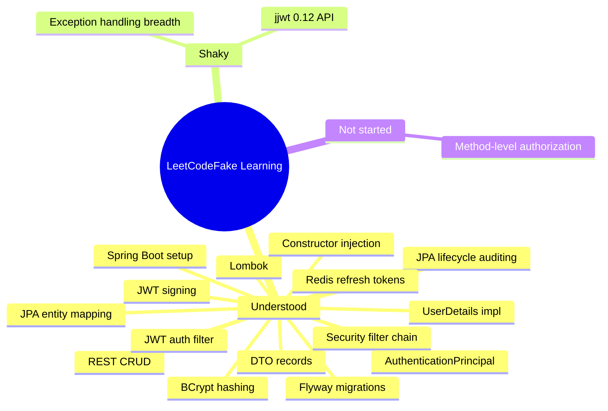

# Learning Log

Current phase: **Phase 3 — Auth (Spring Security + JWT), finishing**

See also: global dev brain at `~/.claude/knowledge/dev-brain.md` — patterns,
tech/approach preferences, and general concepts that carry over to future
projects live there; this file stays scoped to this project's learning.

## Concepts & Knowledge

| Concept | Status | Last touched | Notes |
|---|---|---|---|
| Spring Boot setup + Maven starters | understood | 2026-07-21 | Project scaffolded from start.spring.io; starters for web, data-jpa, security, redis |
| JPA entity mapping | understood | 2026-07-21 | `@Entity`/`@Table`/`@Id`/`@GeneratedValue(IDENTITY)`/`@Column`/`@Enumerated(STRING)` on User, Problem |
| JPA lifecycle auditing | understood | 2026-07-21 | `@PrePersist`/`@PreUpdate` set createdAt/updatedAt/createdBy/updatedBy |
| Lombok builders/accessors | understood | 2026-07-21 | `@Builder`/`@Getter`/`@Setter`/`@NoArgsConstructor`/`@AllArgsConstructor` |
| Constructor injection | understood | 2026-07-21 | Explicit constructors instead of `@Autowired` fields (git: "learning: jpa + constructor") |
| Flyway migrations | understood | 2026-07-21 | Versioned SQL, `ddl-auto: validate` so Hibernate doesn't fight Flyway |
| REST CRUD controllers | understood | 2026-07-21 | `@RestController`/`@GetMapping`/`@PostMapping`/`@PathVariable`/`@RequestBody` on ProblemController |
| DTOs as Java records | understood | 2026-07-21 | Request/response records (AuthResponse, UserDTO, ProblemResponse) — never expose entity |
| Spring Security filter chain | understood | 2026-07-21 | `SecurityFilterChain`, stateless sessions, `permitAll` matchers, `DaoAuthenticationProvider` |
| BCrypt password hashing | understood | 2026-07-21 | `BCryptPasswordEncoder` bean; passwords encoded on register |
| User implements UserDetails | understood | 2026-07-21 | getAuthorities → `ROLE_` prefix; username = email; account-status booleans return true |
| JWT auth filter | understood | 2026-07-21 | `JwtAuthFilter extends OncePerRequestFilter`; parse Bearer, validate, populate SecurityContext |
| JWT signing (jjwt) | understood | 2026-07-21 | HS256; access-token generation + claim extraction |
| Redis refresh tokens | understood | 2026-07-21 | `StringRedisTemplate`, UUID token keyed `refresh:<t>` with TTL — went beyond the plan |
| `@AuthenticationPrincipal` | understood | 2026-07-21 | Inject current UserDetails into `/auth/me` |
| Method-level authorization | shaky | 2026-07-24 | Understands the design (service-layer placement, `ROLE_` prefix, `@EnableMethodSecurity` toggle); `@PreAuthorize` not applied to `POST /problems` yet (HW-3B) |
| Authorization layer placement (controller vs service) | understood | 2026-07-24 | Reasoned correctly that service layer is safest — reusable across controllers/workers/listeners, closest to the protected logic |
| SecurityContextHolder — read current user | shaky | 2026-07-24 | Grasps the chain (getContext→getAuthentication→getPrincipal, cast to User) and the producer/consumer link with JwtAuthFilter; syntax still needs reps. Null-auth (unauthenticated) case is the next check |
| JPA audit fields (createdBy/updatedBy) | understood | 2026-07-24 | Hit NOT NULL constraint, fixed by passing `user.getEmail()` manually. Aware Spring JPA Auditing (@CreatedBy/AuditorAware) can automate this later |
| Exception handling breadth | shaky | 2026-07-21 | Handler only covers ResourceNotFound; register throws raw IllegalArgumentException (→500 not 409); no validation (400) handler |
| jjwt 0.12.x API | shaky | 2026-07-21 | Using deprecated 0.11 style (`parserBuilder`/`setSubject`/`SignatureAlgorithm`); plan uses `Jwts.parser().verifyWith()`/`.subject()` |

Status values: `not-started`, `shaky`, `understood`.

## Mind Map

## Session Journal

### 2026-07-21
- Covered: reviewed the whole auth codebase against `docs/backend-plan.md` to map what's implemented vs. what remains. Set up the coaching + learning-log infrastructure (this file, PROGRESS.md, dev-brain registration).
- User asked: what to do next in the project; to synthesize learned/implemented knowledge; whether a project-tied coaching skill exists (it does — global `learn-mode` + `ask` + `learning-log`).
- Stuck on / revisit next time: the 3 open Phase-3 threads — (1) `@PreAuthorize`/`@EnableMethodSecurity` admin gate, (2) exception handling for duplicate-email (409) and validation (400), (3) migrating jjwt to the 0.12.x API. Good candidates for the next Socratic coaching session.

### 2026-07-24

- Covered: role-based authorization design (`@PreAuthorize` + `@EnableMethodSecurity`) via checklist/reading-list, not code. Then `SecurityContextHolder` chain (getContext→getAuthentication→getPrincipal) and its producer/consumer link to `JwtAuthFilter`.
- User asked: where to place `@PreAuthorize` if multiple controllers/workers call the same service method — answered correctly (service layer, reusable, closest to protected logic) without prompting. Completed HW-3A; hit a NOT NULL bug on `createdBy`/`updatedBy` and fixed it by passing `user.getEmail()` manually; asked how to read the current user from `SecurityContextHolder`.
- Stuck on / revisit next time: `SecurityContextHolder` syntax needs more reps; hasn't yet reasoned through the unauthenticated case (`getAuthentication()` when no JWT was sent) — posed as the next self-check question. `@PreAuthorize` itself still not applied to `POST /problems`.
